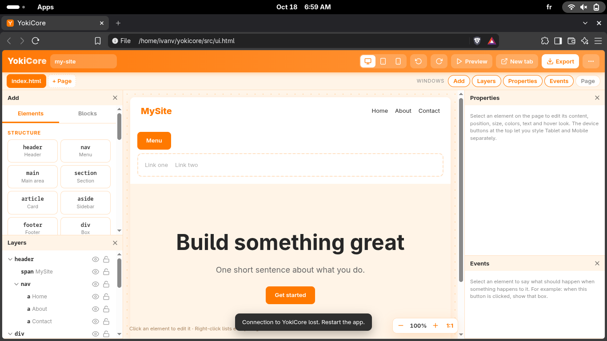

# YokiCore

A small visual website builder that runs on your own machine. You drag elements onto a page, style them, wire up a few events, and export plain HTML, CSS and JavaScript. No account, no cloud, no framework.

The program is one C file with the editor UI embedded in it. It opens a local server on a random port, launches your browser, and quits when you close the tab.


## Install

Download the setup file for your system from the [latest release](../../releases/latest) and double-click it.

| System  | File                       |
| ------- | -------------------------- |
| Windows | `YokiCore-Setup.bat`       |
| macOS   | `YokiCore-Setup.command`   |
| Linux   | `YokiCore-Setup.sh`        |

The three files are identical. The extension only decides how your system opens them. The script downloads the two source files it needs, builds the app with a C compiler, installs the result, and deletes everything else.

- Windows: installs to `%USERPROFILE%\YokiCore\app` and adds a Desktop shortcut. If there is no compiler it installs WinLibs through winget.
- macOS: installs `YokiCore.app` into `~/Applications`. If the Command Line Tools are missing it starts their installer and asks you to run the file again. On first launch macOS may ask you to confirm opening a file downloaded from the internet.
- Linux: installs to `~/YokiCore/app` and adds a menu entry. If there is no compiler it tries apt, dnf, pacman, zypper or apk.

Linux needs the file to be executable before a file manager will run it: `chmod +x YokiCore-Setup.sh`, or run `sh YokiCore-Setup.sh`.

Exported sites are written to `YokiCore/<project-name>` inside your home folder.


## How to Download

| OS      | Download |
|---------|----------|
| Windows | [`YokiCore-Setup.bat`](YOUR_WINDOWS_LINK) |
| macOS   | [`YokiCore-Setup.command`](YOUR_MACOS_LINK) |
| Linux   | Run the following command: |

**Linux**
```bash
git clone https://github.com/erec2smith/YukiCore.git
cd YukiCore
chmod +x YokiCore-Setup.sh
./YokiCore-Setup.sh
```


## Using it



**Windows.** The editor is made of windows: Add, Layers, Properties, Events and Page. Fold one by clicking its title, close it with the x, bring it back from the Windows buttons in the bar under the header. When a side has no open windows, the canvas takes the space.

**Pages.** Every page is a tab under the header. Double-click a tab to rename it, use the x to delete it, `+ Page` to add one.

**Position and layers.** Select an element and open Position & Layer. Set `position` to `absolute` (or press the move button in the selection bar) and you get exact X, Y and Z fields. Arrow Up and Down inside a number field step the value, with Shift for steps of 10. On the canvas you can also nudge with the arrow keys, drag by the grip in the selection bar, and resize from any of the eight handles. Front, back, forward and backward buttons renumber the z-index of the siblings for you.

**Reaching things that are covered.** Alt+click selects the element underneath the current one, and repeating it keeps going down. Right-click lists everything under the cursor. In the Layers window the eye hides an element in the editor only, and the lock makes it ignore clicks so you can get to what is behind it.

**Events.** Select an element, open Events, add a rule:

    When  [this element]  [is clicked]
    Do    [Show / hide (toggle)]
    On    [div#menu-box]

Triggers: click, double-click, hover, hover end, focus, blur, typing, change, form submit, scrolls into view, page opens, and N seconds after the page opens. Actions: show, hide, toggle, add/remove/toggle a class, change text, change a style, play an animation, scroll to, go to a page, open a link in a new tab, show a message, copy text. Elements can start hidden with the checkbox in Content. Rules are compiled into `js/script.js` on export and run in Preview too.


**Preview.** `Preview` shows the page inside the editor. `New tab` opens it in a real browser tab, with links between pages working. Hitting it again reuses the same tab.


**Blocks.** The Blocks tab in the Add window has a navbar, hero, feature cards, card, contact form, call to action, footer and a toggle menu that already uses an event. The welcome screen offers three starting points.

The full shortcut list is under Keyboard shortcuts in the three-dots menu.

## Build from source

You need a C compiler. Nothing else.

    make
    make test

On Windows without make, run `build.bat` (needs `gcc`, for example from MinGW-w64 or WinLibs).

`src/ui.html` is the editor. `make` converts it to `src/ui.h` with `tools/embed.c` and compiles `src/main.c`. Commit `ui.h` after changing `ui.html`, the installer downloads it from the repository.

## What an export contains

    my-site/
      index.html
      about.html
      css/base.css
      css/index.css
      css/about.css
      js/script.js
      assets/
      project.json

Images you add are saved to `assets/` instead of being inlined. `project.json` can be loaded back with Open project file.

## Security notes

The server only listens on `127.0.0.1`. Every request that writes anything must carry a random token that is generated at startup and handed to the page it serves. Tab previews live under a path that contains the same token. The server shuts down about six seconds after the editor tab closes.

## Setting up the repository

Replace `OWNER/YokiCore` at the top of `setup/YokiCore-Setup.sh` and in the PowerShell block at the bottom, then copy the file over the `.command` and `.bat` versions. The installer downloads `src/main.c` and `src/ui.h` from the `main` branch.

Screenshots go in `docs/img/`:

- `editor.png`: the full editor with a landing page loaded and all windows open
- `layers.png`: a few overlapping elements with the Layers window and selection handles visible
- `events.png`: the Events window with two rules on a button
- `preview.png`: the exported page in a browser tab with the address bar showing

## License

MIT. See `LICENSE`.
